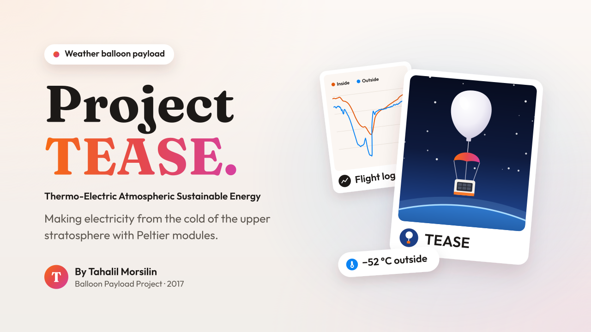
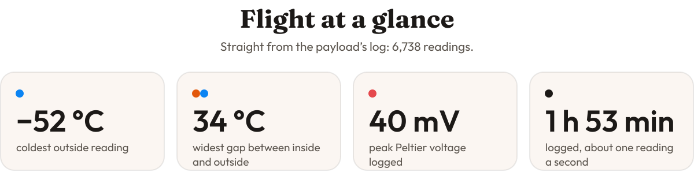
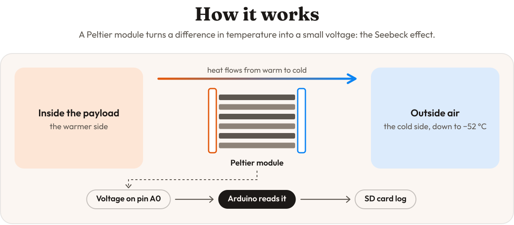
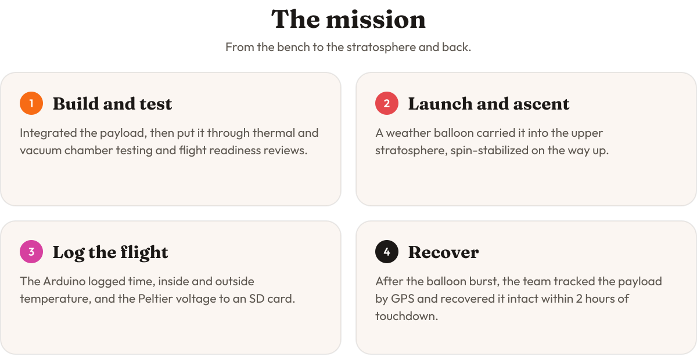
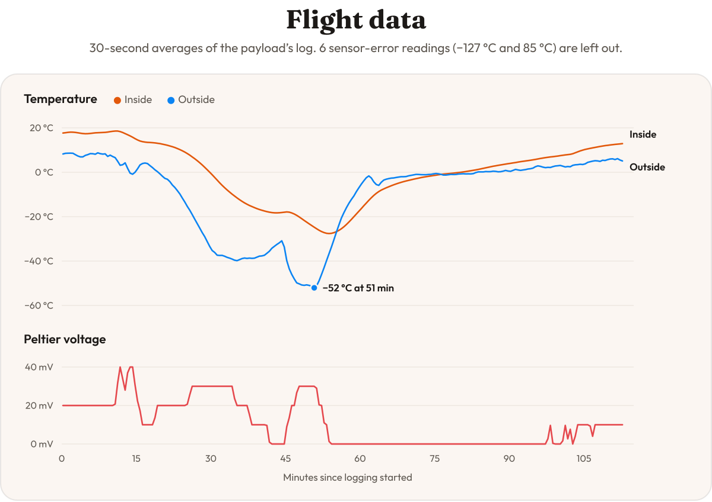

<br>

<p align="center">
  A weather balloon payload that made electricity from the cold of the upper stratosphere.
  Peltier modules turned the gap between the warm inside of the payload and the freezing air outside into voltage,
  and an Arduino logged the whole flight to an SD card.
</p>

<br>

<picture>
  <source media="(prefers-color-scheme: dark)" srcset="assets/stats-dark.svg">
  
</picture>

<br>
<br>

<picture>
  <source media="(prefers-color-scheme: dark)" srcset="assets/how-it-works-dark.svg">
  
</picture>

<br>
<br>

<picture>
  <source media="(prefers-color-scheme: dark)" srcset="assets/mission-dark.svg">
  
</picture>

<br>
<br>

<picture>
  <source media="(prefers-color-scheme: dark)" srcset="assets/flight-data-dark.svg">
  
</picture>

<p align="center">
  <sub>Every reading is in <a href="data/tease-flight-data.csv"><code>data/tease-flight-data.csv</code></a>. The original spreadsheet, with its charts, is <a href="data/tease-flight-data.xlsx"><code>data/tease-flight-data.xlsx</code></a>.</sub>
</p>

## Mission outcomes

- Showed thermoelectric energy harvesting working in near-space conditions.
- Produced a clean flight dataset for academic publication.
- Took the payload from concept through testing, flight and recovery.
- The payload became the baseline for follow-on student missions.

> [!NOTE]
> **From the mission write-up.** Across the full payload, with cascaded Peltier stages and separate instruments, the team reported a peak open-circuit voltage of 380 mV at apogee, and the payload survived −57 °C and 4 mb of pressure. Those readings aren't in this repository's log, which comes from the temperature-and-voltage logger in [`firmware/`](firmware/).

## Payload hardware

| Part | What it does | Used by the code here |
| --- | --- | :---: |
| Arduino (C++) | Flight computer and data logger | ✓ |
| Peltier (Seebeck) modules | Turn the temperature difference into voltage | ✓ |
| DS18B20 temperature sensors | Inside and outside temperature | ✓ |
| DS3231 real-time clock | A timestamp for every reading | ✓ |
| SD card | Stores the flight log | ✓ |
| BMP388 barometric sensor | Pressure and altitude | |
| u-blox GPS | Position, for tracking and recovery | |
| Custom PCB, cryogenic-rated components | Hold up in the cold | |
| FAA Class 1 weather balloon | Carries the payload to the upper stratosphere | |

## Flight software

[`firmware/vetrov-00.cpp`](firmware/vetrov-00.cpp) is the Arduino sketch that flew. On every loop it reads the clock, both temperature sensors and the Peltier voltage, prints them over serial, and appends them to `test02.txt` on the SD card.

**Wiring**

| Signal | Pin |
| --- | --- |
| SD card chip select | 4 |
| Outside DS18B20 (OneWire) | 8 |
| Inside DS18B20 (OneWire) | 2 |
| Peltier voltage (0–5 V) | A0 |
| DS3231 clock | SDA, SCL |

**Libraries:** SPI and SD (built into the Arduino IDE), OneWire, DallasTemperature, and DS3231 by Rinky-Dink Electronics.

**To run it:** create a new sketch in the Arduino IDE, replace its contents with `firmware/vetrov-00.cpp`, install the libraries above, and upload.

**What it writes** (one block per reading):

```text
Time: 00:00:01
Outside temperature: 8.06
Inside temperature: 17.56
Current voltage: 0.02
-----------------------------------------
```

## Repository layout

```text
firmware/vetrov-00.cpp         Arduino flight software
data/tease-flight-data.csv     The flight log: time, outside and inside temperature, voltage
data/tease-flight-data.xlsx    The original spreadsheet, with charts
assets/                        Images for this README
```

## Contact

For details on assembling the payload, email [tahalil106@gmail.com](mailto:tahalil106@gmail.com).
